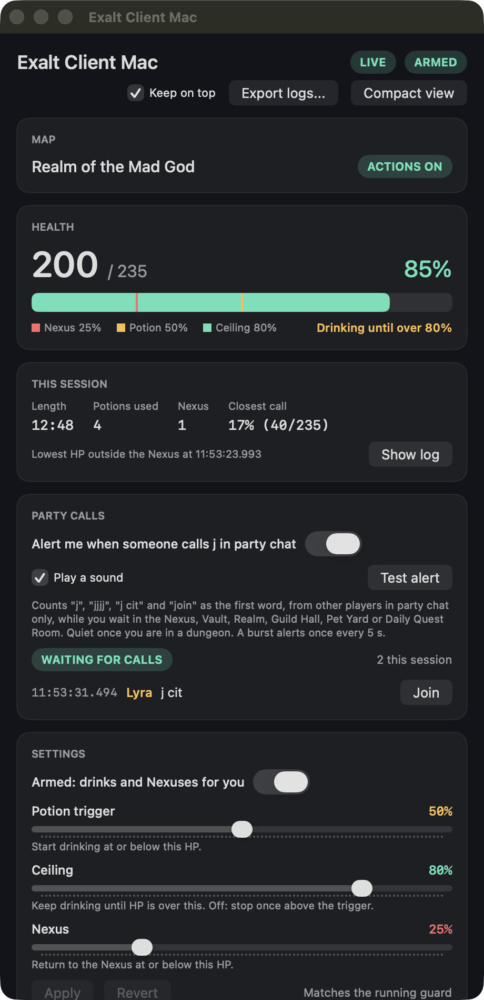
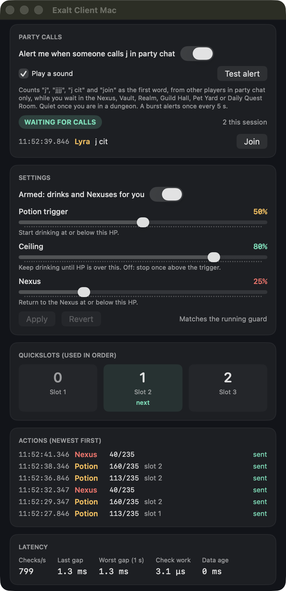
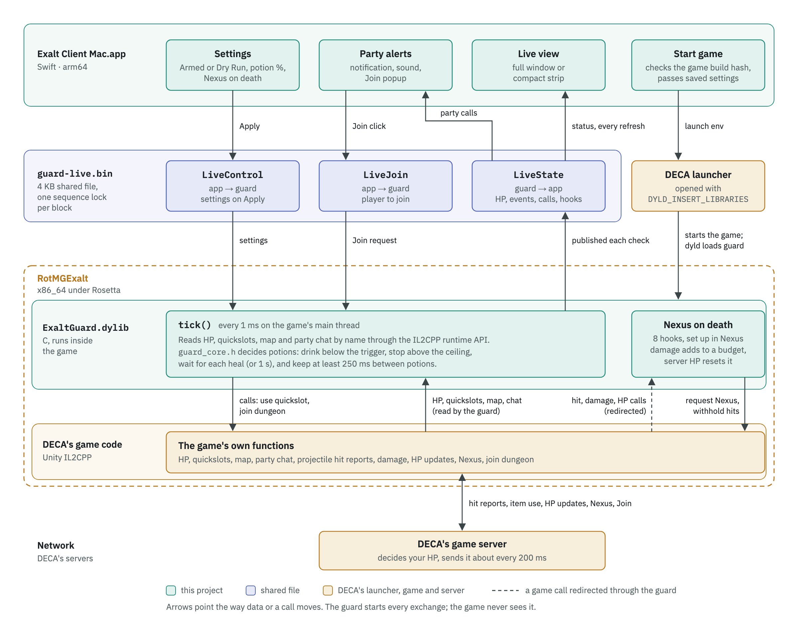
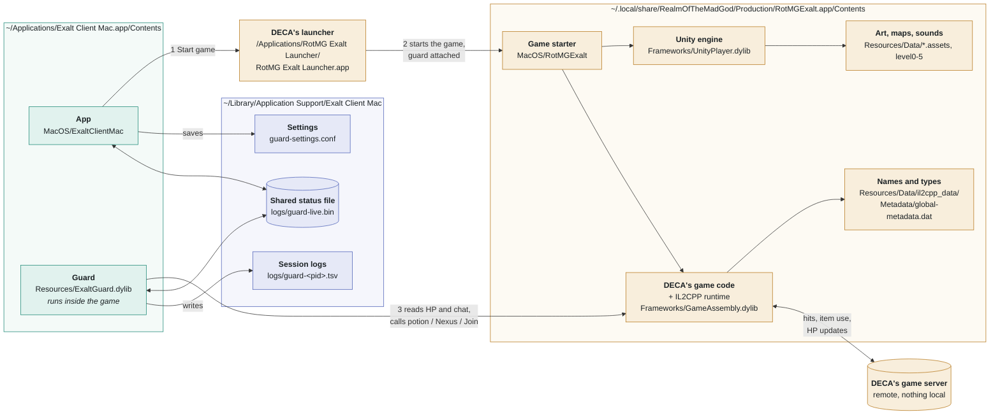

# Exalt Client Mac

A local macOS companion for Realm of the Mad God Exalt. It launches the game through DECA's launcher and provides configurable health protection, party-call alerts, and a live status window.

## Features

| Feature | Behavior |
| --- | --- |
| **Nexus on death** | Predicts lethal projectile damage and requests Nexus before reporting the fatal hit. Once the game confirms the local Nexus state, the fatal and subsequent projectile reports are withheld during escape. Optional and off by default. |
| **Auto-potion** | Starts drinking at the potion trigger and continues until HP exceeds the ceiling. Uses quickslots in order and waits for healing before drinking again. |
| **Party-call alerts and Join** | Alerts when another party member calls “j” or “join” while you are in a waiting area. Offers a one-click Join button in the main window, popup, and compact strip. |
| **Live display** | Shows HP, map, quickslots, recent actions, session totals, and timing measurements. Switch between the full window and an always-on-top compact strip. |
| **Saved settings and logs** | Apply settings while the game runs, retain them for future launches, and export session logs with your settings. |

**Armed** enables automatic health actions. **Dry Run** records predicted actions without drinking, automatically requesting Nexus, or suppressing damage. Party alerts and the user-clicked Join button remain available.

<p>
  
  &nbsp;
  
</p>

<details>
<summary>Full window</summary>
<p>
  
  &nbsp;
  
</p>
</details>

These screenshots use synthetic test data and illustrate the window layouts. The current app also includes the Nexus on death checkbox and its readiness status.

## Build and install

Requirements:

- Apple silicon Mac running macOS 13 or later.
- Rosetta for the Intel Exalt game and integration library.
- DECA's launcher installed in `/Applications`, with Exalt installed in its default location.
- Xcode command-line tools (`xcode-select --install`) and Python 3 for building and testing.

Quit the game, launcher, and any running Exalt Client Mac instance before the full build.

```sh
git clone https://github.com/ehongkuo/exalt-client-mac.git "$HOME/Development/exalt-client-mac"
cd "$HOME/Development/exalt-client-mac"
./build.sh
```

If the repository is already cloned, run `./build.sh` from that checkout. The script runs the tests, builds and signs the app, then installs it at `~/Applications/Exalt Client Mac.app`.

The installed app contains its integration library and supported-game fingerprint. Running it does not require the repository, dumper, or diagnostic launcher.

## Start the game

1. Open **Exalt Client Mac** from `~/Applications` or Launchpad.
2. Choose your settings and click **Apply**. A fresh installation starts in Dry Run, with Nexus on death off.
3. Click **Start game**, then **Play** in DECA's launcher.
4. For Nexus on death, enter Nexus and wait for **Nexus on death ready** before leaving.
5. Use **Test alert** in Party calls to check notifications and sound.

Always start the game through Exalt Client Mac to load its integration. An already-running game keeps the library it loaded at launch; restart it through the app after installing a new version.

The launcher checks the installed game's fingerprint before starting. A game update requires checking and updating the integration for that build.

## Configure health protection

The defaults are a 50% potion trigger and an 80% potion ceiling, with Nexus on death off. Saved potion and death-toggle settings retain your values. Legacy percentage Nexus values are discarded when settings are loaded or sent to the guard.

- **Potion trigger:** start drinking at or below this percentage. Off disables automatic potions.
- **Ceiling:** continue drinking until HP is above this percentage. Off stops drinking above the potion trigger. If the potion trigger is Off, the ceiling must also be Off.
- **Nexus on death:** enable predicted lethal-projectile intervention, the only automatic Nexus mode. Requires Armed and prepared hooks.

To use **only Nexus on death**:

1. Switch **Armed** on first.
2. Set **Potion trigger** and **Ceiling** to **Off** by moving both sliders fully left.
3. Check **Nexus on death** and click **Apply**.
4. Wait in Nexus for the readiness message.

The Armed switch applies immediately. Set it before editing other controls: while connected, switching it can replace pending edits with the current running settings. Other edits take effect when you click Apply.

Nexus on death can also run alongside potions. Once a predicted-death escape starts, further health actions pause and damage suppression stays latched until Nexus arrival or a validated player/map/connection change. Turning the toggle or Armed off does not cancel that escape in progress.

## How it works



Arrows point the way data or a call moves. The game never calls the guard; the source for this diagram is [docs/architecture.html](docs/architecture.html).

The Apple silicon UI loads an Intel C library into Exalt for that launch. The library reads validated game fields through Unity's IL2CPP runtime and calls the game's existing potion, Nexus, and Join functions.

Auto-potions use observed HP. The polling timer requests checks at 1 ms intervals on the game's main thread; actual scheduling varies with game load and is shown in the timing display. Nexus on death runs synchronously in the audited projectile calculation path, before the corresponding hit report.

Incoming player HP assignments replace the prediction baseline and clear retained damage. Calculated projectile damage accumulates between those assignments. A predicted HP of zero or below requests Nexus. Suppression begins only after the local Nexusing flag is confirmed. Failed requests preserve the original damage path and are logged.

The app and library exchange state, settings, and Join requests through a small shared-memory file. Installed game files are unchanged. See [the architecture walkthrough](docs/how-it-works.md) and [the intervention notes](docs/nexus-on-death.md) for more detail.

### Where each part lives on your Mac



Every box is a real file on your Mac, except the server. Green is installed by this project, amber is DECA's (installed by their launcher), blue is data the app and guard write. The guard's file sits in the app, but it runs inside the game once the launcher starts it.

## Design notes
## Validation and limits

Live tests have demonstrated predicted-death escapes both in the standalone diagnostic and in the integrated app with potions disabled. Tested cases include low-HP crossings and rapid multi-shot bursts. The integrated app has automated coverage for Armed, Dry Run, toggle off, HP resets, denied requests, exceptions, changing settings during escape, and legacy settings without any percentage Nexus fallback.

This is experimental protection. It currently covers the audited projectile path, and does not guarantee survival from every damage source or network condition. A delayed HP update can clear damage still in flight; previously sent reports cannot be recalled. A confirmed local Nexus flag is not a server acknowledgement.

The integration is specific to the game build recorded in `guard/game-build.sha256`. Method signatures, field types, offsets, and native entry bytes are validated before the death hooks are installed in Nexus. Readiness failures are shown in the app.

## Development

```sh
./build.sh --test-only   # runs the checks, including a brief synthetic UI test
./build.sh --app-only    # builds and installs without running tests
```

The automated tests use a simulated game/runtime and do not act on the real game. Close the game before running the UI checks. A running client must be closed before installing its replacement; a running game can keep its existing integration until the next launch.

| Path | Purpose |
| --- | --- |
| `app/` | SwiftUI windows, settings, live-state models, launcher, log export, icon generators, and model tests. |
| `guard/` | IL2CPP bindings, potion decisions, potions, Nexus, party chat/Join, shared-state protocol, logging, and game fingerprint. |
| `probe/` | Shared production damage hooks and prediction policy, plus standalone diagnostic tools. Its production headers are required by the app build. |
| `tests/` | Synthetic game fixtures, guard/integration tests, native-hook regressions, shared-memory checks, and UI fixtures. |
| `tools/` | Command-line utilities for reading live state and sending settings or Join requests. |
| `docs/` | Architecture notes, intervention notes, and screenshots. |
| `build/`, `module-cache/` | Generated binaries and compiler caches, excluded from Git. |

Settings and session logs live in `~/Library/Application Support/Exalt Client Mac/`. The app's **Export logs** button bundles the session logs and saved settings into a zip.

🤖 Generated with Codex
