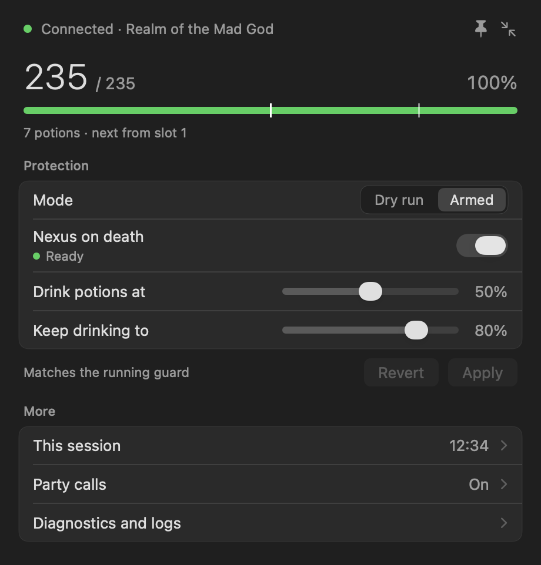
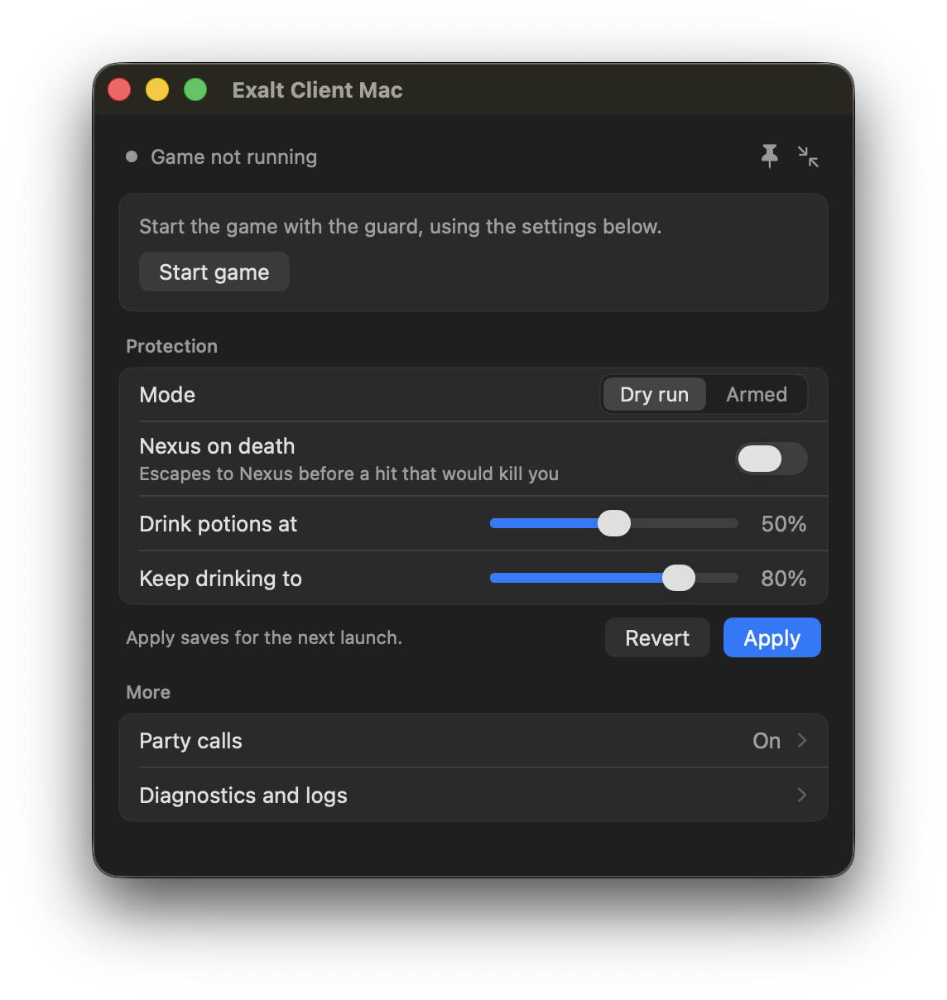
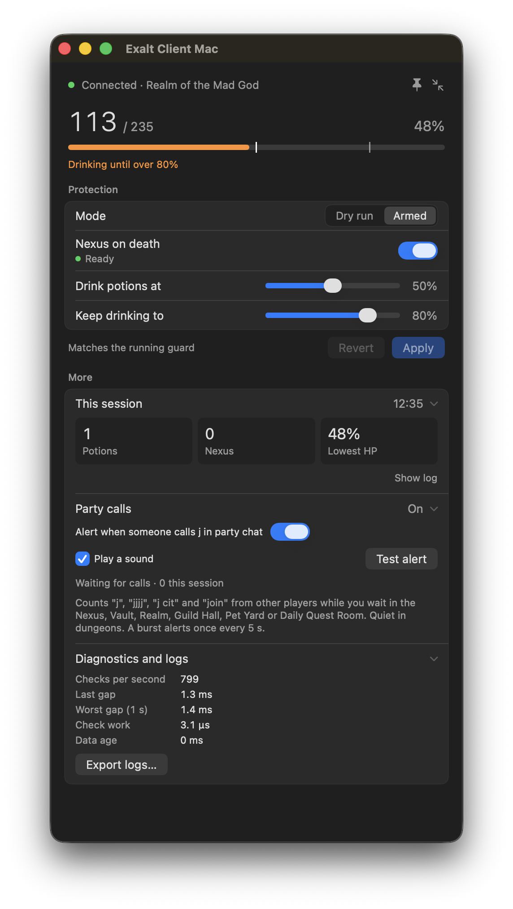
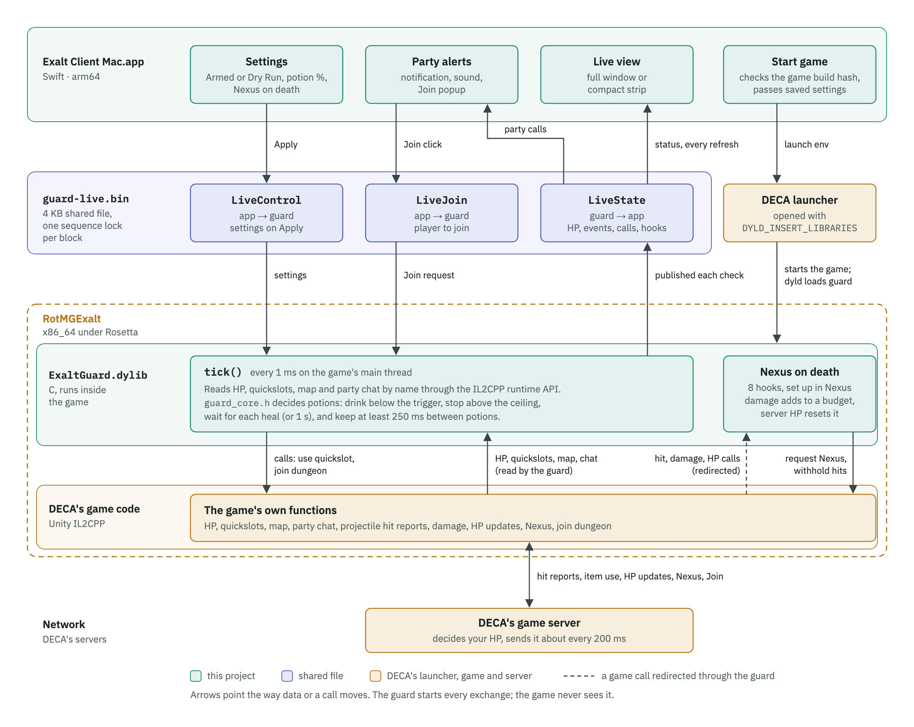
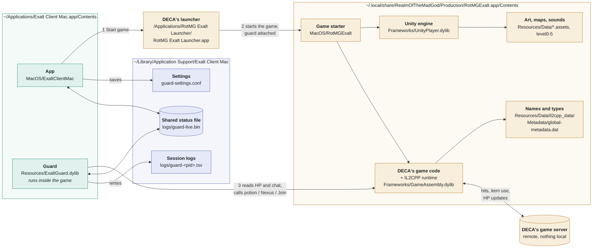

# Exalt Client Mac

A local macOS companion for Realm of the Mad God Exalt. It starts the game through DECA's launcher with a small guard library loaded, then drinks potions for you, can escape to the Nexus before a hit that would kill you, and alerts you to party calls with a one-click Join.

<p align="center">
  
</p>

## Features

| Feature | Behavior |
| --- | --- |
| **Nexus on death** | Predicts lethal audited projectile, ground and radius/AOE damage and requests Nexus before the fatal hit is reported. Once the game confirms the local Nexus state, the fatal and later projectile reports are withheld during the escape. Optional and off by default. |
| **Auto-potion** | Starts drinking at the potion trigger and keeps going until HP is over the ceiling. Uses quickslots in order and waits for each heal to show before drinking again. |
| **Party calls and Join** | Alerts when another party member calls "j" or "join" while you wait in the Nexus, Vault, Realm, Guild Hall, Pet Yard or Daily Quest Room. A popup over the game, also in full screen, joins their dungeon in one click. |
| **Live window** | Shows connection, map, HP, potions, protection status, session totals and timing. Shrinks to an always-on-top strip. |
| **Saved settings and logs** | Apply settings while the game runs; they are kept for the next launch. Export session logs with your settings. |

**Armed** drinks and Nexuses for you. **Dry run** only records what it would do: no potions, no automatic Nexus, no withheld damage. Party alerts and Join work in both.

## Build and install

Requirements:

- Apple silicon Mac running macOS 13 or later.
- Rosetta for the Intel Exalt game and integration library.
- DECA's launcher installed in `/Applications`, with Exalt installed in its default location.
- Xcode command-line tools (`xcode-select --install`) and Python 3 for building and testing.

Quit the game, launcher, and any running Exalt Client Mac instance before the full build.

```sh
git clone https://github.com/ehongkuo/exalt-client-mac.git "$HOME/Development/exalt-client-mac"
cd "$HOME/Development/exalt-client-mac"
./build.sh
```

If the repository is already cloned, run `./build.sh` from that checkout. The script runs the tests, builds and signs the app, then installs it at `~/Applications/Exalt Client Mac.app`.

The installed app contains its integration library and supported-game fingerprint. Running it does not require the repository, dumper, or diagnostic launcher.

## Start the game



1. Open **Exalt Client Mac** from `~/Applications` or Launchpad. It shows **Game not running** and a **Start game** button.
2. Choose your settings and click **Apply**. A fresh installation starts in **Dry run**, with Nexus on death off.
3. Click **Start game** (⌘R), then **Play** in DECA's launcher. The window goes live when the game loads.
4. For Nexus on death, enter the Nexus and wait until **Nexus on death** reads **Ready** before leaving.
5. Use **Test alert** under **More › Party calls** to check the popup and sound.

If [RealmHound](https://github.com/pillarzz/RealmHound) is installed, **Also open RealmHound** next to **Start game** opens it with the game (on by default, remembered). It reads game traffic passively and needs one-time capture access: `brew install --cask wireshark-chmodbpf`.

**More → Drop alerts** plays a sound and shows a popup at the top of the screen when RealmHound logs a bag you chose (White, Orange (UT) and Red (ST) by default), optionally only at a minimum rarity (enchantment slots), and for any shiny item. It reads RealmHound's loot log read-only, so RealmHound has to be running. The popup has no buttons: it goes after 10 s, or when clicked.

<br clear="right">

Always start the game through Exalt Client Mac to load its integration. An already-running game keeps the library it loaded at launch; restart it through the app after installing a new version.

The app checks the installed game's fingerprint before starting. DECA's launcher can update the game after that, so the guard checks the fingerprint again when the game loads. A game update requires checking and updating the integration for that build.

The guard does not let a game run unprotected. If the fingerprint, a method, a field, the chat or join code, or (with Nexus on death on) the death hooks fail their checks, or the game never becomes ready within 2 minutes, the guard closes the game. The app then shows **Game closed: guard checks failed** with the reason, plays a sound and posts a notification, whatever the party alert settings say. A game running without the guard for 20 seconds, for example one started straight from DECA's launcher, gets the same warning.

## The window

From top to bottom:

- **Status line:** connection and map, for example **Connected · Realm of the Mad God**. The pin keeps the window on top (on by default, remembered); the arrows switch to the compact strip.
- **Health:** current and maximum HP with a bar. The two marks on the bar are the potion trigger and the ceiling. The bar is green, orange at or below the trigger, and red during a Nexus escape. The line under it shows the potions left and the next slot, or what the guard is doing: **Drinking until over 80%**, **Escaping to Nexus**, **Out of potions**.
- **Protection:** **Mode**, **Nexus on death** with its status, and the two potion sliders. The line under the group says where your edits stand: **Matches the running guard**, **Edited, not applied**, **Applied to the running guard**, or, with no game running, **Apply saves for the next launch**. **Revert** drops your edits.
- **More:** three rows that open in place.
  - **This session** (or **Last session** after the game closes): play time, potions and Nexus escapes used (or, in Dry run, that would have been used), and the lowest HP outside the Nexus. **Show log** reveals the session log in Finder.
  - **Party calls:** turn alerts and the sound on or off, and **Test alert**.
  - **Diagnostics and logs:** checks per second, timing gaps, check work, data age, and **Export logs…**.

<details>
<summary>The window with every More row open</summary>
<p align="center">
  
</p>
</details>

### Compact strip and Join popup

<p>
  
  &nbsp;
  
</p>

The **compact strip** floats above the game with the mode, HP and potions; its arrows bring the full window back. When a party call arrives it names the caller with a blue outline.

The **Join popup** appears at the top of the screen, over the game and over full-screen video. **Join** runs the game's own **Join dungeon** and brings the game to the front. The popup closes once you are in a dungeon, 4 seconds after a join goes through, or after 90 seconds. Calls in a dungeon don't alert, and a burst of calls alerts once every 5 seconds.

These screenshots use synthetic test data. `tools/readme-screenshots.sh` regenerates them.

## Configure health protection

The defaults are a 50% potion trigger and an 80% potion ceiling, with Nexus on death off. Saved potion and death-toggle settings keep your values. Legacy percentage Nexus values are discarded when settings are loaded or sent to the guard.

- **Drink potions at** (potion trigger): start drinking at or below this percentage. Off disables automatic potions.
- **Keep drinking to** (ceiling): continue drinking until HP is above this percentage. Off stops drinking above the trigger. If the trigger is Off, this must also be Off.
- **Nexus on death:** escape before predicted lethal damage, the only automatic Nexus. It acts only in Armed mode once its hooks are ready; Dry run logs what it would do. Its status reads **Ready**, **Watching only (dry run)**, **Enter Nexus to prepare**, **Escaping to Nexus**, or **Unavailable for this game build**.

To use **only Nexus on death**:

1. Set **Mode** to **Armed** first.
2. Set **Drink potions at** and **Keep drinking to** to **Off** by moving both sliders fully left.
3. Turn on **Nexus on death** and click **Apply**.
4. Wait in the Nexus until it reads **Ready**.

**Mode** applies immediately. Set it before editing other controls: while connected, switching it can replace pending edits with the current running settings. Other edits take effect when you click **Apply**.

Nexus on death can also run alongside potions. Once a predicted-death escape starts, further health actions pause and damage suppression stays latched until Nexus arrival or a validated player/map/connection change. Turning the toggle or Armed off does not cancel an escape in progress.

## How it works



Arrows point the way data or a call moves. The game never calls the guard; the source for this diagram is [docs/architecture.html](docs/architecture.html).

The Apple silicon UI loads an Intel C library into Exalt for that launch. The library reads validated game fields through Unity's IL2CPP runtime and calls the game's existing potion, Nexus, and Join functions.

Auto-potions use observed HP. The polling timer requests checks at 1 ms intervals on the game's main thread; actual scheduling varies with game load and is shown in the timing display. Nexus on death runs synchronously at audited projectile calculations and ground/area notifications, before their corresponding reports.

Recent audited damage is kept as pending hits in a fixed 128-entry ledger shared by projectile, ground and area paths. Each hit is paired with the next tick reply the client sends, which travels behind the hit's report on the same connection. A hit clears only once a later server tick's round-trip value proves the server received that reply, plus a 200 ms margin; HP changes and elapsed time never clear a hit, and server HP is only the baseline. A projected HP (server HP minus pending damage) of zero or below requests Nexus; a positive hit while server updates have stalled for at least 1.5 s, or a full ledger, also requests a conservative escape. Suppression begins only after the local Nexusing flag is confirmed. Failed requests preserve the original damage path and are logged. See the [beach stress tests](docs/beach-stress-tests.md).

The app and library exchange state, settings, and Join requests through a small shared-memory file. Installed game files are unchanged. See [the architecture walkthrough](docs/how-it-works.md) and [the intervention notes](docs/nexus-on-death.md) for more detail.

### Where each part lives on your Mac



Every box is a real file on your Mac, except the server. Green is installed by this project, amber is DECA's (installed by their launcher), blue is data the app and guard write. The guard's file sits in the app, but it runs inside the game once the launcher starts it.

## Validation and limits

Live tests have demonstrated predicted-death escapes both in the standalone diagnostic and in the integrated app with potions disabled. Tested cases include low-HP crossings and rapid multi-shot bursts. The integrated app has automated coverage for Armed, Dry Run, toggle off, HP resets, denied requests, exceptions, changing settings during escape, and legacy settings without any percentage Nexus fallback.

This is experimental protection. It covers audited projectile, ground and radius/AOE paths, and does not guarantee survival from every damage source or network condition. A hit the server has already applied stays pending until its proof arrives, so it can count twice and cause an early escape. A hit clears 200 ms after proof that the server received it; if the server applies it later than that, it is no longer counted. Previously sent reports cannot be recalled. A confirmed local Nexus flag is not a server acknowledgement.

The integration uses the reviewed profile selected by `compatibility/active-profile.txt`. That profile generates `guard/build_profile.h` and `guard/game-build.sha256`; see [build compatibility](compatibility/README.md) for the read-only update-analysis command. Method signatures, field types, offsets, and native entry bytes are validated when the game starts; a failure closes the game (exit code 78) and is shown in the app. Diagnostic builds record the failure without closing the game.

## Development

For damage-source discovery, see the [native coverage map](docs/damage-sources.md) and
[in-game test checklist](docs/damage-testing.md). `sh probe/build-probe.sh` builds an observation-first
diagnostic under `build/damage-diagnostic/`, with isolated session bundles and no installed-app replacement.

```sh
./build.sh --test-only   # runs the checks, including a brief synthetic UI test
./build.sh --app-only    # builds and installs without running tests
./build.sh --stage       # tests + "Exalt Client Mac Staging.app" in build/, not installed
```

The automated tests use a simulated game/runtime and do not act on the real game. Close the game before running the UI checks. A running client must be closed before installing its replacement; a running game can keep its existing integration until the next launch.

| Path | Purpose |
| --- | --- |
| `app/` | SwiftUI windows, settings, live-state models, launcher, log export, icon generators, and model tests. |
| `guard/` | IL2CPP bindings, potion decisions, potions, Nexus, party chat/Join, shared-state protocol, logging, and game fingerprint. |
| `probe/` | Shared production damage hooks and prediction policy, plus standalone diagnostic tools. Its production headers are required by the app build. |
| `tests/` | Synthetic game fixtures, guard/integration tests, native-hook regressions, shared-memory checks, and UI fixtures. |
| `tools/` | Command-line utilities for reading live state and sending settings or Join requests, and the README screenshot script. |
| `docs/` | Architecture notes, intervention notes, and screenshots (regenerate with `tools/readme-screenshots.sh`). |
| `build/`, `module-cache/` | Generated binaries and compiler caches, excluded from Git. |

Settings and session logs live in `~/Library/Application Support/Exalt Client Mac/`. Session logs and diagnostic recordings are deleted when the app starts if they haven't been written to for 14 days. **Export logs…** under **More › Diagnostics and logs** bundles the session logs and saved settings into a zip.

🤖 Generated with Codex
