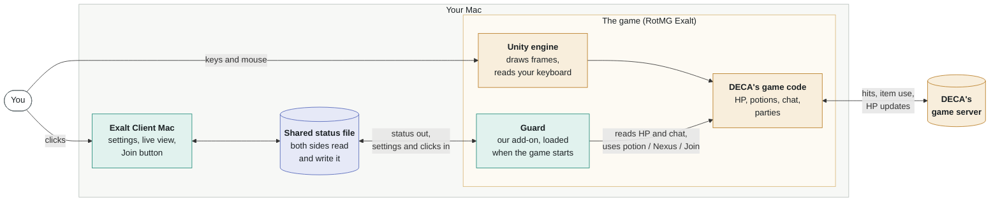
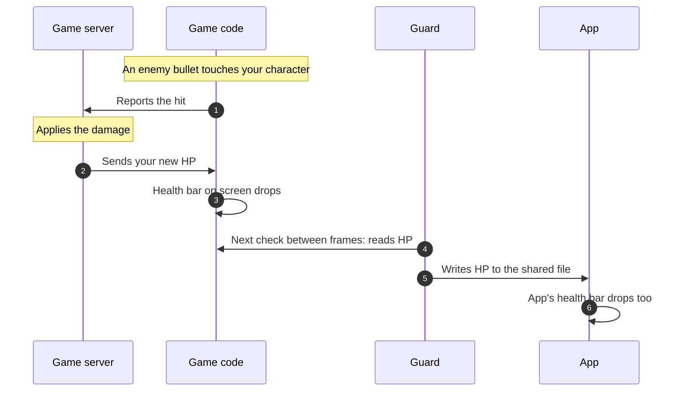
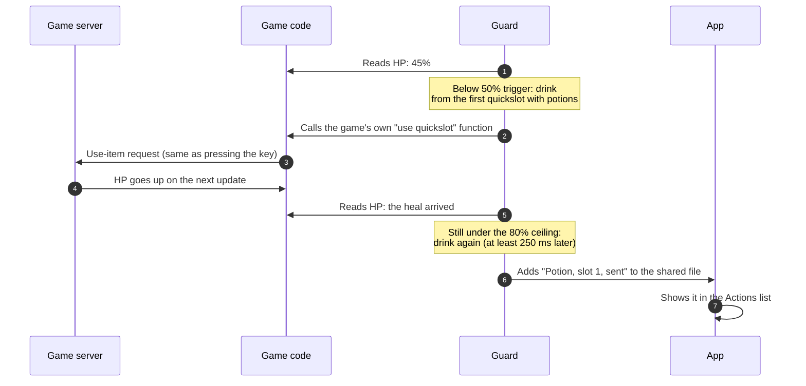
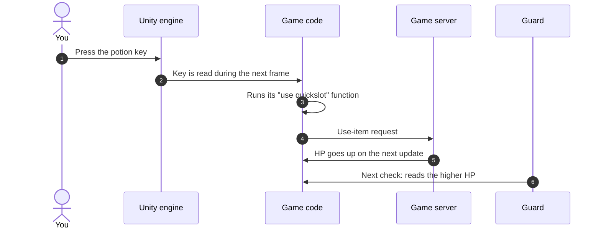
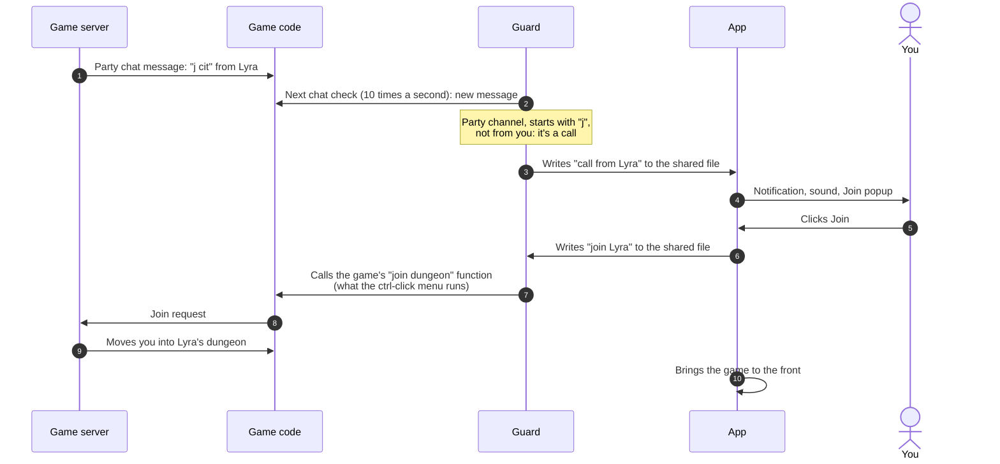

# How it works

Exalt Client Mac has two parts: the **app** you see, and a small **guard** that runs inside the game. This page shows how they fit together with the game and DECA's server, then follows four everyday events from start to finish.

## The big picture

Green is this project, amber is DECA's game and server, blue is the file the app and guard share. The app also starts the game, which is how the guard gets loaded into it.

A few things to know before the traces:

- **The guard only uses the game's own functions.** It reads values the game already has (like your HP) and calls the same functions the game's keys and menus call. It never edits game code or network traffic.
- **The guard checks in between frames.** The game draws a frame, then the guard takes a quick look (about 3 microseconds), roughly every 6 to 7 ms during combat.
- **The server is in charge of your HP.** The game shows the HP the server last sent, about every 200 ms. Everything the guard does is based on that number.

## Trace 1: You take damage

An enemy bullet hits you. Nothing here is started by the guard; it watches.

The delay that matters is step 3: HP only changes when the server's update arrives. That is why a single huge hit can still kill you; there is no moment in between for anything to react.

## Trace 2: The guard drinks a potion

Your HP falls below the potion trigger (50% by default) while **Armed** is on.

The guard waits for each heal to show up (or 1 second) before drinking another, so it can't empty a stack while the server is catching up. If HP keeps falling to the Nexus threshold (25%), the same path calls the game's "go to Nexus" function instead.

## Trace 3: You press the potion key yourself

The guard isn't involved here. This trace is for comparison with Trace 2.

Steps 3 to 5 are exactly what the guard triggers in Trace 2. The only difference is who starts it: your key press, or the guard's decision.

## Trace 4: Someone calls "j" and you click Join

This is the one trace that starts in the app.

Calls only alert while you're in the Nexus, Vault, Realm and other waiting areas, and go quiet once you're in a dungeon.

## Where this lives in the code

| Part | File | What to look for |
| --- | --- | --- |
| Starting the game with the guard | `app/GuardLaunch.swift` | `DYLD_INSERT_LIBRARIES` |
| Guard startup | `guard/guard.c` | `start()`: runs as the guard loads, starts its timers |
| Finding the game's functions | `guard/guard.c` | `prepare()`: looks up classes, fields and methods by name through the IL2CPP API |
| The check between frames | `guard/guard.c` | `tick()`: read HP, decide, act, check chat, publish |
| The decisions | `guard/guard_core.h` | thresholds, ceiling, pacing; pure C, no game access |
| Shared status file | `guard/live_state.h` | layout and the lock-free sequence lock |
| Alerts, popup, Join button | `app/GuardApp.swift`, `app/GuardModel.swift` | `PartyAlerts`, `JoinPopupRules` |
